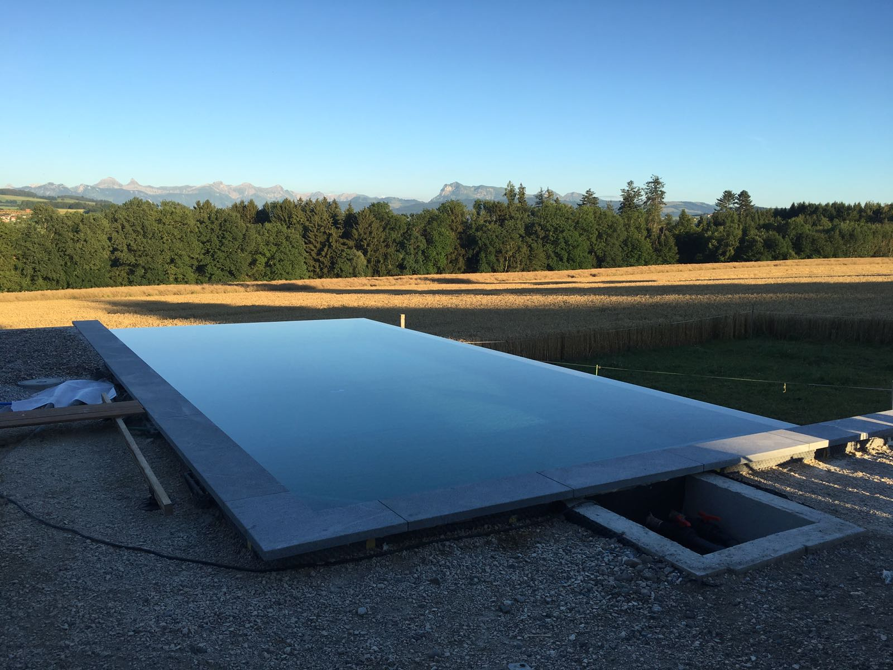

# 🏊 Poupool - The swimming pool controller

**Poupool** is a swimming pool control software.

It is based on [Transitions](https://github.com/pytransitions/transitions),
[Pykka](https://github.com/jodal/pykka) and [Paho MQTT](https://github.com/eclipse-paho/paho.mqtt.python).
The user interface is built using [Home Assistant](https://www.home-assistant.io/)
(with Lovelace dashboards) or any MQTT client to interact with the
system.

This is meant as a *personal project* and will likely never be a fully-featured software. However, it
would be awesome to see it running somewhere else. Poupool runs on a **Raspberry Pi 3 Model B** and most
of the hardware is COTS (*commercial off-the-shelf*). If you want more information, feel free to
contact me.

Originally, I wanted to experiment with `asyncio` but finally chose to go with a more traditional
approach (actor model and finite state machines).

Poupool currently controls **filtration** (including backwash), **heating** (heat pump), **pH and
chlorination**, **cover**, **lights** and all the pumps and valves of the system. It is used for an overflow
swimming pool so that adds some complexity to the control process (e.g. monitoring of the retention
tank water level).

The main interaction with the system is done through modes. Here are some of the main ones:

* 🌿 **eco** : cover close, filtration, pH, chlorination and heating are automatic
* ⏸️ **standby** : cover open, no overflow
* 🌊 **overflow** : cover open, overflow, chlorination is forced
* 🛋️ **comfort** :  cover open, no overflow, heating is forced

Several other features are available like a **wintering state** stirring the pool to avoid as long as
possible having the water freeze, a stirring feature when the cover is closed to dissipate the
heat forming just under the cover, the control of a swimming pump and more.

You can use the Home Assistant companion apps on iOS or Android, use the provided
Lovelace dashboard (`home-assistant/dashboard.yaml`), or interact directly via the MQTT API.

## 📦 Dependencies

These are the external dependencies that can be installed via `uv`. You will also need **Python 3.11+**.
Best is to setup a virtual environment by running `uv sync`.

### 🏗️ Frameworks:
* **[Pykka](https://github.com/jodal/pykka)** - Python implementation of the actor model
* **[transitions](https://github.com/pytransitions/transitions)** - Lightweight, object-oriented finite state machine implementation
* **[paho-mqtt](https://github.com/eclipse-paho/paho.mqtt.python)** - MQTT client library
* **[astral](https://github.com/sffjunkie/astral)** - Calculations for the position of the sun and twilight

### 🍓 Raspberry Pi:
* **[RPi.GPIO](https://sourceforge.net/projects/raspberry-gpio-python/)** - Control Raspberry Pi GPIO channels
* **[adafruit-circuitpython-ads1x15](https://github.com/adafruit/Adafruit_CircuitPython_ADS1x15)** - CircuitPython driver for ADS1x15 ADCs
* **[adafruit-circuitpython-mcp4725](https://github.com/adafruit/Adafruit_CircuitPython_MCP4725)** - CircuitPython driver for MCP4725 I2C DAC

### 📱 User interface:
* **[Home Assistant](https://www.home-assistant.io/)** - Open-source home automation platform

### 🛠️ Development tools:
* **[uv](https://github.com/astral-sh/uv)** - Fast Python package and project manager
* **[ruff](https://github.com/astral-sh/ruff)** - Fast Python linter and code formatter
* **[ty](https://github.com/astral-sh/ty)** - Fast Python type checker
* **[pytest](https://github.com/pytest-dev/pytest)** - Testing framework
* **[PlatformIO](https://platformio.org/)** - Build and flash the Arduino firmware (see `arduino/cover/README.md`)
