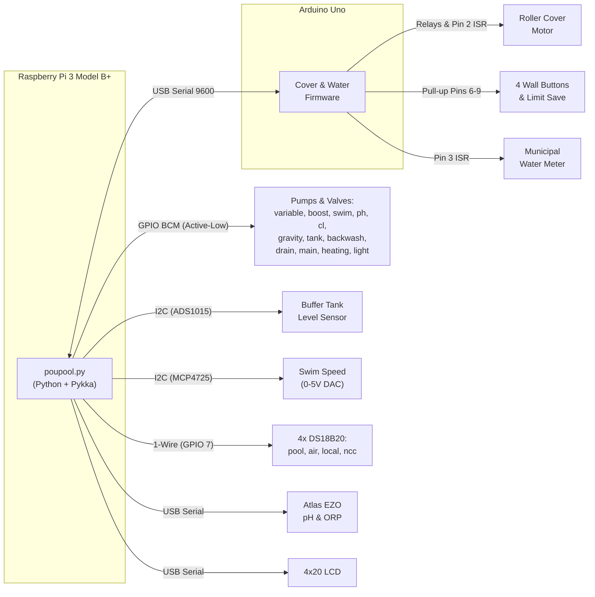
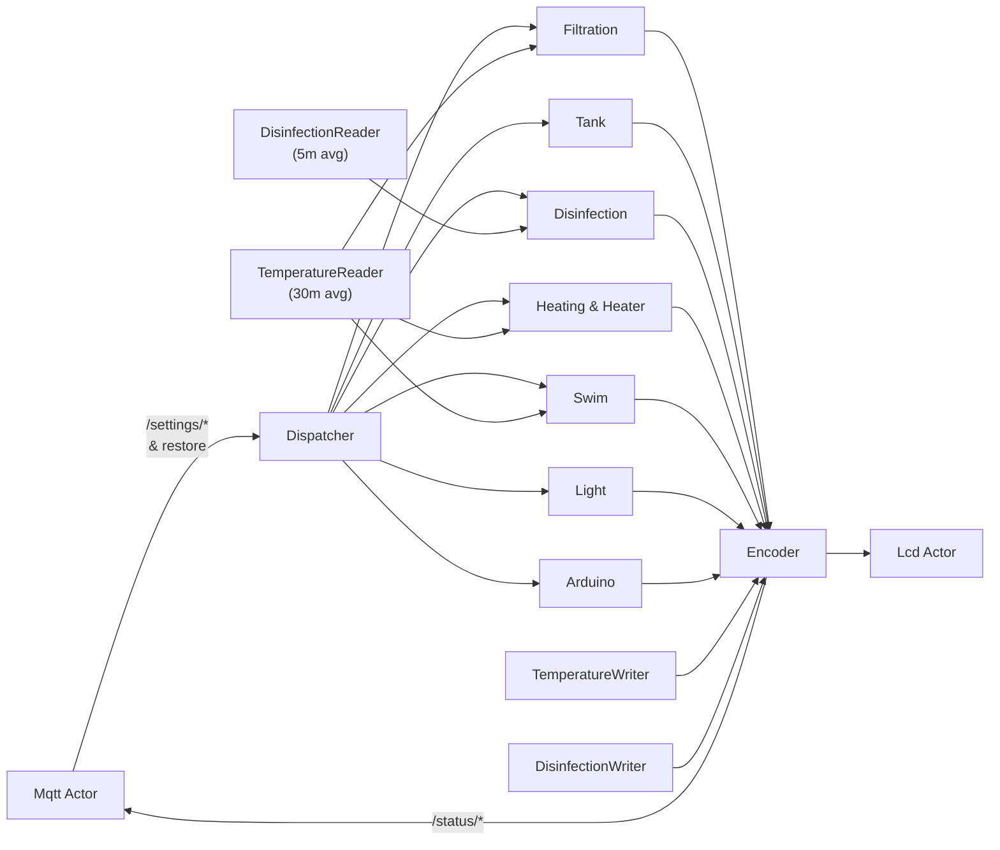

# System & Hardware

Poupool splits responsibilities cleanly between two boards: a Raspberry Pi 3 Model B+ runs the control software and drives all hydraulic relays and water-chemistry probes, while an Arduino Uno handles real-time pulse counting and safety interlocks for the roller cover and municipal water meter.

## Hardware split: Raspberry Pi vs Arduino

The Raspberry Pi 3 runs Linux, the Mosquitto MQTT broker, and the Python controller (`poupool.py`). It controls every pump and valve relay directly through GPIO, reads the buffer tank level over I2C, sets the counter-current swim speed over I2C, reads four 1-Wire temperature sensors, queries Atlas Scientific EZO pH and ORP circuits over USB-serial, and updates the 4x20 LCD display.

The Arduino Uno runs standalone C++ firmware (`arduino/cover/src/main.cpp`). Keeping cover timing on a microcontroller guarantees deterministic pulse counting from the cover motor and immediate emergency stops if the motor stalls or moves past its calibrated limits, even if the Raspberry Pi reboots or loses serial communication. Physical wall buttons wire straight to the Arduino so you can always open, close, or recalibrate the cover locally.

## Hydraulic circuit

<figure class="figure-card">
  
  <figcaption>Water flows between the pool basin, perimeter gutter, buffer tank, sand filter, heat pump, and dosing chamber.</figcaption>
</figure>

The pool basin, perimeter gutter, and buffer tank share water through two suction branches. Depending on the active mode, Poupool pulls water from the pool through the `gravity` line or from the buffer tank through the `tank` valve. Downstream of the filtration pump and sand filter, water passes through the heat pump loop, the pH/ORP measurement chamber, and the chemical injection points before returning to the pool jets.

During a filter backwash, the `backwash` and `drain` valves redirect pressurized water backwards through the sand bed and out to the sewer. The counter-current swim pump sits on its own independent closed loop with a dedicated pit temperature sensor (`temperature_ncc`).

### Pumps and valves controlled by the Raspberry Pi

| Name | Type | Default BCM Pin(s) | Role |
| :--- | :--- | :--- | :--- |
| `variable` | 4-pin pump | `26, 21, 20, 16` | Variable-speed main filtration pump (speeds 0 to 3) |
| `boost` | Switch relay | `4` | Secondary booster pump for surface skimming and overflow boost |
| `swim` | Switch + DAC | `17` + I2C | Counter-current swim pump relay and analog speed control |
| `ph` | Switch relay | `25` | Peristaltic dosing pump for pH-minus |
| `cl` | Switch relay | `12` | Peristaltic dosing pump for liquid chlorine |
| `gravity` | Valve relay | `22` | Controls direct gravity/suction path from the pool |
| `tank` | Valve relay | `13` | Opens suction from the buffer tank |
| `backwash` | Valve relay | `5` | Reverses flow through the sand filter |
| `drain` | Valve relay | `6` | Opens waste line to the sewer during backwash and rinse |
| `main` | Valve relay | `19` | Municipal fresh-water refill solenoid for the buffer tank |
| `heating` | Valve relay | `23` | Enables the pool heat pump |
| `light` | Valve relay | `27` | Underwater pool lights |

All relay outputs are active-low (`False` turns a device on, `True` turns it off), and every pump and valve is turned off automatically when Poupool exits cleanly.

## Software architecture

Instead of one monolithic control loop, Poupool breaks each subsystem into an independent **Pykka** actor running its own **Transitions** hierarchical state machine (`Filtration`, `Tank`, `Disinfection`, `Heating`, `Heater`, `Swim`, `Light`, `Arduino`, `Mqtt`, and `Lcd`). Each actor owns its own timers and hardware devices and communicates with neighboring actors through asynchronous proxy messages.

Incoming MQTT messages arrive at the `Mqtt` actor and pass through `Dispatcher`, which validates payloads and invokes the matching actor method. Outgoing telemetry passes through `Encoder`, which translates method calls into `/status/...` MQTT topics and updates the local `Lcd` cache in parallel.

Sensor readers smooth noisy raw values before any control decision uses them. `TemperatureReader` polls the four 1-Wire sensors every minute and keeps a 30-minute moving average (plus a pool heating slope in °C/hour), while `DisinfectionReader` averages pH and ORP readings over a 5-minute window.
