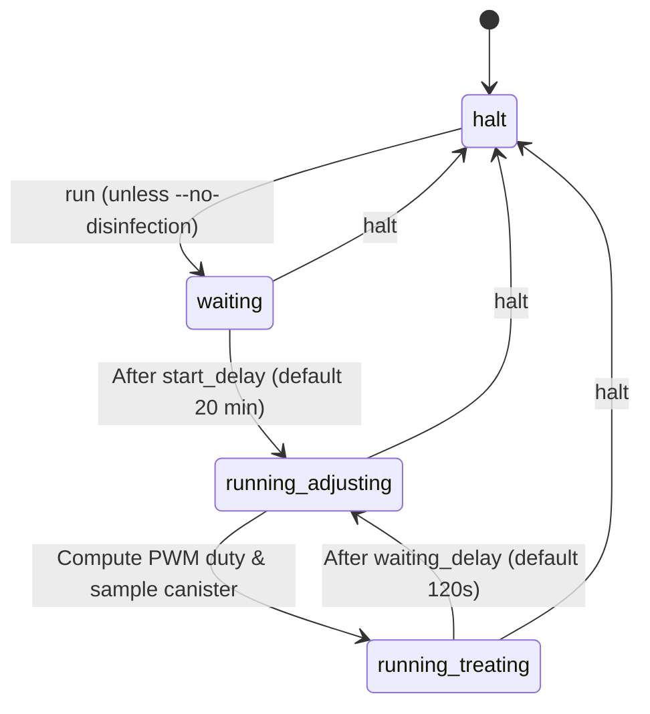
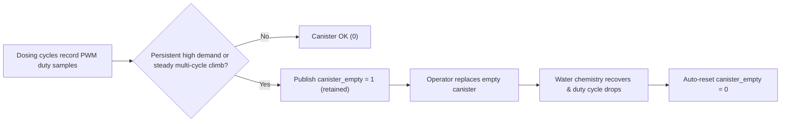

# Disinfection

Poupool automates water balance with two peristaltic dosing pumps: one injects pH-minus (acid) and the other injects liquid chlorine. Water chemistry is read from Atlas Scientific EZO pH and ORP circuits mounted in the measurement chamber downstream of the filter.

## Startup settling and measurement loop

Whenever filtration starts running in an eligible mode (`eco_normal`, `heating_running`, `standby` with `speed_standby > 0`, `overflow` at speed 1 or 2, or `comfort`), `Filtration` starts the `Disinfection` actor.

When filtration first turns on, water sitting inside the probe chamber has been stagnant since the last cycle and often gives misleading readings. To avoid dosing on stale water, `Disinfection` stays in `waiting` for `start_delay` seconds (default `1200` s, or 20 minutes) before starting the dosing pumps and the telemetry writer. During that delay, and whenever `Disinfection` is in `halt`, pH and ORP values are not published to MQTT.

Once active, `DisinfectionReader` polls both EZO probes every minute and maintains a 5-minute moving average. `DisinfectionWriter` publishes those smoothed readings once a minute to `/status/disinfection/ph/value` and `/status/disinfection/orp/value`.

{: .note }
During `overflow` at speed 3 or 4, `eco_tank`, `sweep`, `closing`, `opening`, and `wash`, `Disinfection` is halted automatically because high flow rates, turbulent suction, or closed circulation loops skew probe readings.

## Proportional PWM dosing and safety cutoff

Every `waiting_delay` seconds (default `120` s), `running_adjusting` compares the 5-minute probe average against your target setpoints and updates the duty cycle of each `PWM` pump actor.

<figure class="figure-card">
  
  <figcaption>Top: PWM on-time shrinks proportionally as pH approaches setpoint. Bottom: rising duty cycles across filtration cycles trigger an empty canister alert, which clears automatically once the canister is replaced.</figcaption>
</figure>

Each pump runs on a repeating `PWM` period (`ph_pwm_period` and `cl_pwm_period`, both `120` s by default). The larger the gap between the probe reading and the setpoint, the longer the pump stays on during that period:

- **pH control**: assumes pH-minus acid is connected. When water pH climbs above `/settings/disinfection/ph/setpoint` (default `7.0`), the pump doses in proportion to the error scaled by `/settings/disinfection/ph/pterm`.
- **ORP control**: when redox potential drops below `/settings/disinfection/orp/setpoint` (default `600` mV), the chlorine pump doses in proportion to the deficit scaled by `/settings/disinfection/orp/pterm`.

To protect relay contacts and peristaltic pump motors from rapid clicking at tiny duty cycles, very short pulses are clamped up to a minimum on-time, and duty cycles near 100% stay continuously on across the boundary. Both loops can be enabled or disabled independently with `/settings/disinfection/ph/enable` and `/settings/disinfection/orp/enable`, and launching `poupool.py` with `--no-disinfection` locks the whole `Disinfection` actor in `halt`.

Each `PWM` actor also enforces a daily runtime budget (`security_duration` in `config.ini`). If a faulty probe or pinched tube causes a dosing pump to exceed its daily limit, `PWM` inhibits further dosing until the next daily reset.

## Empty chemical canister detection

Physical float switches inside sulfuric acid or liquid chlorine jugs corrode and stick quickly. Instead of relying on extra hardware in the canister, Poupool detects an empty canister in software by watching how dosing effort behaves across filtration cycles (`canister_cycles` in `config.ini`, default `3`).

When a canister runs dry, the dosing pump keeps running at higher and higher duty cycles because water pH or ORP never catches up. Once Poupool sees sustained unfulfilled demand across `canister_cycles` consecutive filtration cycles (roughly 12 to 18 hours of filtration), it flags `/status/disinfection/ph/canister_empty` or `/status/disinfection/cl/canister_empty` as `1` (retained).

When you swap in a full canister, the next active dosing pass brings pH or ORP back toward target, duty cycles fall back down, and the alert clears itself automatically to `0` without needing manual acknowledgement. Both flags survive controller restarts through retained MQTT messages and map directly to Home Assistant `problem` binary sensors so you can wire up push notifications.
