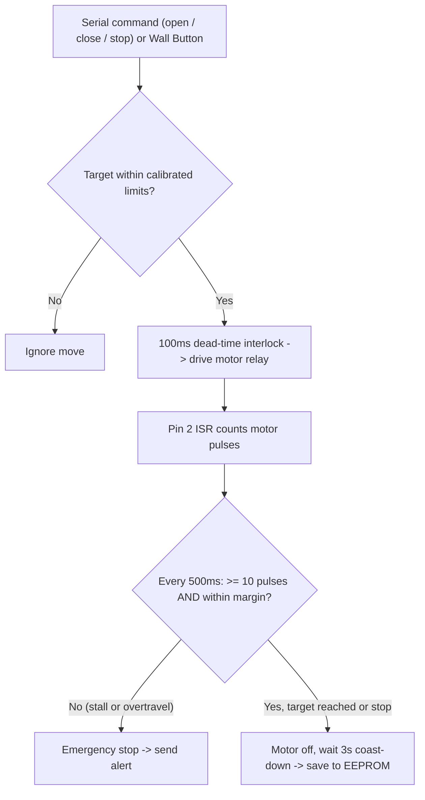
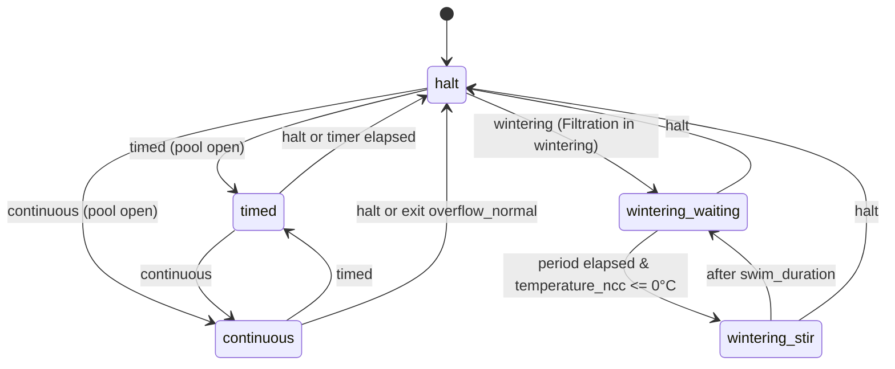

# Cover, Swim Pump & Lighting

Beyond filtration and water chemistry, Poupool controls the motorized roller cover, municipal water meter, counter-current swimming jets, and underwater pool lighting.

## Motorized roller cover and water meter

Cover motion and municipal water pulse counting live on the **Arduino Uno** (`arduino/cover/src/main.cpp`), talking to the Raspberry Pi `Arduino` actor over a `9600` baud USB-serial link (`/dev/arduino`). When the Raspberry Pi opens the serial port, it disables hangup-on-close (`stty -hupcl`) so connecting or restarting Python does not reset the Arduino mid-travel.

### Motor safety, coast-down, and EEPROM protection

When switching direction, the firmware waits `100` ms before energizing the active relay so open and close circuits cannot fight each other. While the motor runs, an interrupt on Arduino pin `2` counts motor encoder pulses (`50` pulses per second) to track position from `0%` (closed) to `100%` (open).

Three safeguards protect every move:
- If fewer than 10 pulses arrive in a 500 ms window (for example, an obstacle jams the slats or a belt slips), the firmware triggers an emergency stop.
- If the pulse counter crosses beyond the saved open or close limits plus a short coasting margin, the firmware also stops immediately.
- A 1-second hardware watchdog resets the microcontroller automatically if the main loop ever hangs.

Because a heavy pool cover coasts for a couple of seconds after cutting power, the Arduino waits `3` seconds after issuing `STOP` before stopping pulse counting and writing the updated position to EEPROM. Writing only after coast-down finishes both prevents position drift and keeps EEPROM writes to a minimum.

### Wall buttons and limit calibration

Four physical push-buttons connect straight to the Arduino (pins `6` to `9`) and take priority over serial commands from the Raspberry Pi:

- **Open / Close (pins `6`, `7`)**: hold to move the cover manually; releasing stops immediately.
- **Save Open / Save Close (pins `8`, `9`)**: press and hold for 2 seconds to enter limit calibration, jog the cover to the desired fully open or closed stop, then release to commit the new endpoint to EEPROM.

In normal operation, `eco` closes the cover down to `/settings/cover/position/eco` (default `0%`), letting you leave the cover partially open if needed. Opening to `standby` or `overflow` always brings the cover to `100%`.

### Municipal water meter

A pulse-output water meter on the fresh-water refill line connects to Arduino interrupt pin `3`. The Raspberry Pi polls the Arduino counter once a minute, adds any new pulses to the running total, and publishes the cumulative count to the retained MQTT topic `/status/water/counter` so totals persist across reboots.

## Counter-current swimming pump

The `Swim` actor controls the counter-current jets using a GPIO relay (`swim`, pin `17`) paired with an **MCP4725** I2C DAC for variable speed from `1%` to `100%` (`/settings/swim/speed`).

As a safety interlock, `Swim` refuses to start in `timed` or `continuous` mode unless `Filtration` is in `standby_normal`, `overflow_normal`, `comfort`, or `wintering`. In `timed` mode, the pump turns off automatically after `/settings/swim/timer` minutes (default `5` min). Leaving `overflow_normal` halts the swim pump automatically.

## Underwater pool lighting

The `Light` actor drives a single relay (`light`, pin `27`) between `halt` and `on` via `/settings/light/mode`. Entering `eco` or `halt` in `Filtration` turns the lights off automatically so they never stay on under a closed cover.
