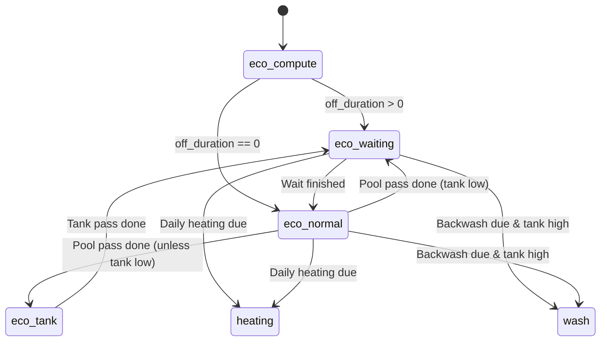
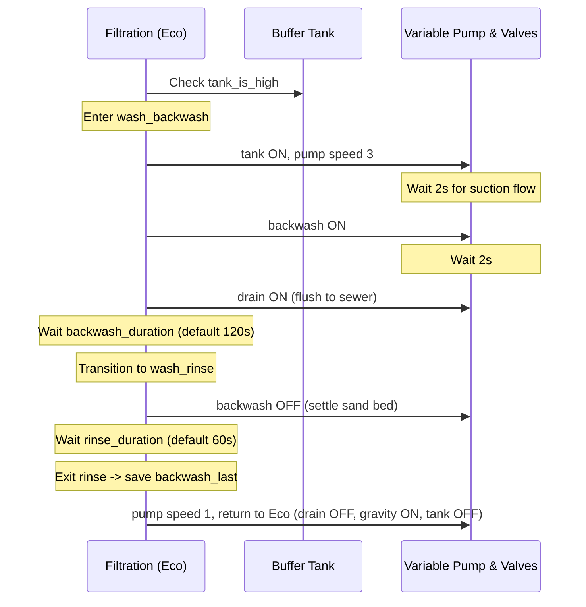

# Filtration & Backwash

Daily filtration in Poupool balances water turnover, buffer tank circulation, solar heat dissipation under the cover, and periodic sand filter backwashes.

## Eco daily scheduling

When `Filtration` enters `eco`, it lands in `eco_compute` to plan the day's work until the next `reset_hour` (midnight by default). It takes three main settings:

- `duration`: total daily filtration time in seconds (default 10 hours / `36000` seconds).
- `period`: how many filtration blocks to spread across the day (default `3`).
- `tank_percentage`: fraction of each filtration block spent drawing from the buffer tank instead of the pool (default `0.1`, i.e. 10%).

From the remaining daily filtration budget and the time left until `reset_hour`, `EcoMode` computes the idle gap (`eco_waiting`), the pool filtration phase (`eco_normal`), and the buffer tank phase (`eco_tank`) for each period.

Filtration time earned outside Eco mode is credited against the daily total as well. Running in `overflow` above speed 2 counts at `1x`, slower `overflow` (speeds 1 and 2) and `comfort` count at `0.5x`, and `standby` counts at `1x` whenever `speed_standby > 0`. The cumulative duration is persisted every 5 minutes on the retained MQTT topic `/status/filtration/duration`, so a reboot mid-day picks up where the pool left off rather than restarting from zero.

<figure class="figure-card">
  
  <figcaption>Example 24-hour Eco cycle with three filtration periods, daytime solar stirring, and a daily heating run.</figcaption>
</figure>

During `eco_tank`, `Filtration` halts disinfection, opens `tank`, and locks the variable pump to speed 1 so the pump cannot drain the buffer tank too quickly or push the pool into overflow. If the buffer tank is low when `eco_normal` ends, `eco_tank` is skipped and the cycle goes straight to `eco_waiting`.

## Variable pump speeds and boost

The `variable` pump supports discrete speeds `0` (off), `1` (low), `2` (medium), and `3` (high) across four GPIO relay outputs. In `overflow` mode, selecting speed `4` runs the variable pump at speed 3 together with the secondary `boost` pump for maximum overflow volume.

Whenever the pool opens from `eco` to `standby` or `overflow`, Poupool automatically runs a boost phase (`standby_boost` or `overflow_boost`) for `boost_duration` seconds (default 5 minutes) to clear surface leaves and floating debris before dropping to normal operating speed.

## Solar cover stirring

When the sun shines directly on a closed roller cover, a thin layer of water just under the slats heats up much faster than the bulk pool water. Left uncirculated, that trapped heat degrades the slats over time and tricks temperature readings.

While in `eco_normal`, `eco_waiting`, or `heating_running`, `StirMode` checks the sun's elevation angle using the configured city (`[misc] location` in `config.ini`, computed via the `astral` library). Whenever the sun sits at or above `solar_elevation` (default `20` degrees), `StirMode` periodically switches on the `boost` pump for `stir_duration` (default 2 minutes) every `stir_period` (default 2 hours) to mix the warm surface layer down into the basin. Setting `stir_period` or `stir_duration` to `0` disables solar stirring.

## Automated sand filter backwash

Sand filters trap dirt over time and need periodic backwashing to waste. You can trigger a backwash manually by setting `/settings/mode` to `wash` while in `eco_normal` or `eco_waiting` (assuming the tank is `high`), or let Poupool trigger it automatically every `backwash/period` days (default `30` days, minimum `2` days) as soon as the buffer tank reaches `high`.

Because a backwash and rinse discharge water straight to the sewer, the buffer tank level drops during the wash. Once Poupool returns to `eco`, the `Tank` actor opens the municipal `main` valve automatically if the level fell below its Eco low threshold.
