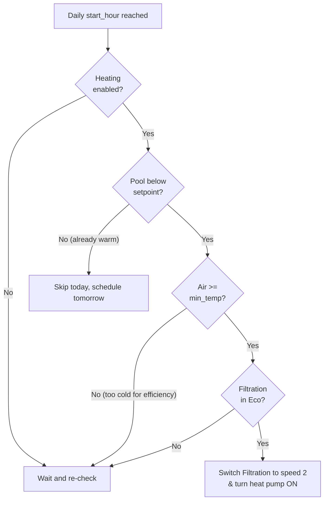
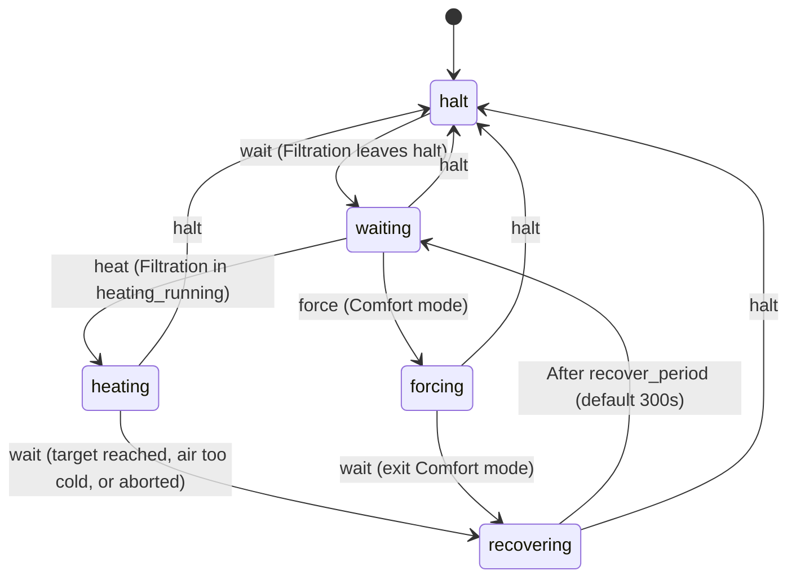
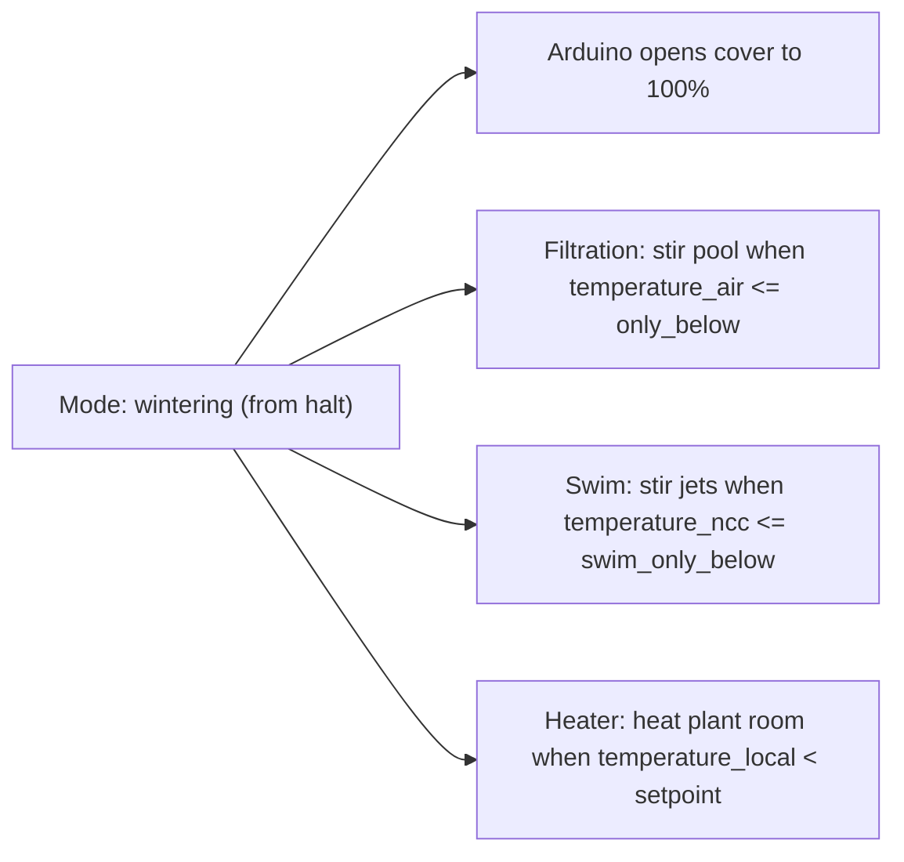

# Heating & Frost Protection

Poupool manages two separate thermal loops: the main pool heat pump (`Heating`) and optional freeze protection (`Wintering` plus a plant-room frost `Heater`).

## Main heat pump scheduling and hysteresis

Every day, the `Heating` actor runs one scheduled check starting at `/settings/heating/start_hour` to decide whether the pool needs warming.

If the pool water is already warm enough at `start_hour`, `Heating` skips heating for the rest of the day and schedules the next check for tomorrow. Changing `/settings/heating/setpoint` pulls the next check back by one day so a higher target starts warming right away without waiting 24 hours.

<figure class="figure-card">
  
  <figcaption>Once ambient air clears min_temp, heating runs with the filtration pump at speed 2 until water reaches setpoint plus hysteresis_up, then keeps water flowing during heating_delay.</figcaption>
</figure>

While in `heating`, the heat pump runs until water reaches `setpoint + hysteresis_up` (default `+0.5 °C`), ambient air drops below `min_temp - hysteresis_min_temp` (default `1.0 °C` below `min_temp`), the pool temperature sensor drops out, or heating is disabled. Exiting `heating` updates the retained runtime counter on `/status/heating/total_seconds`, schedules the next daily run for tomorrow, puts `Heating` into `recovering` for `recover_period` seconds (default `300` s) to protect the compressor from short-cycling, and transitions `Filtration` into `heating_delay`.

That cool-down delay keeps water circulating through the heat exchanger after the compressor shuts off (`delay_to_eco` = `60` s when returning to Eco, or `delay_to_open` = `30` s if you open the pool to Stand-by or Overflow while heating).

In **Comfort** mode, `Filtration` puts `Heating` into `forcing`, which turns the heat pump relay on immediately regardless of `start_hour` or `min_temp`.

## Wintering and frost protection

Putting the pool into `wintering` (from `halt`) coordinates three separate freeze safeguards across the pool, counter-current pit, and technical room:

Opening the roller cover prevents surface ice from crushing or jamming the slats. Meanwhile, `Tank` remains in `halt` so the buffer tank stays drained and the municipal refill valve stays locked shut.

- **Pool water stirring (`Filtration`)**: every `wintering.period` (default 3 hours), if `temperature_air` is at or below `wintering.only_below` (default `5 °C`) or unreadable, the variable pump runs at `wintering.pump_speed` (default speed `1`) for `wintering.duration` (default 30 minutes).
- **Counter-current pit stirring (`Swim`)**: every `wintering.swim_period` (default 3 hours), if `temperature_ncc` is at or below `wintering.swim_only_below` (default `0 °C`) or unreadable, the swim pump runs for `wintering.swim_duration` (default `60` s).
- **Technical room heater (`Heater`)**: if a `heater` relay is registered, `Heater` monitors `temperature_local` against `/settings/heater/setpoint` (default `3.0 °C` in `default_settings.py`) using `[heater]` `hysteresis_down` (`0.5 °C`) and `hysteresis_up` (`2.0 °C`). If the plant-room sensor drops out, `Heater` fails safe and turns the space heater on.
