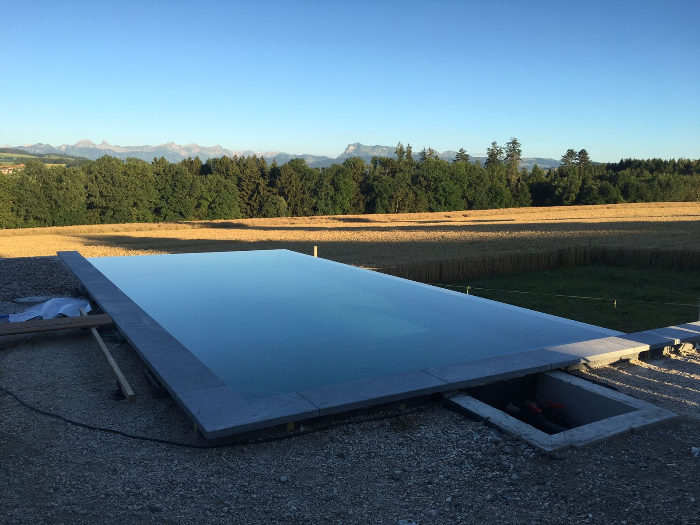
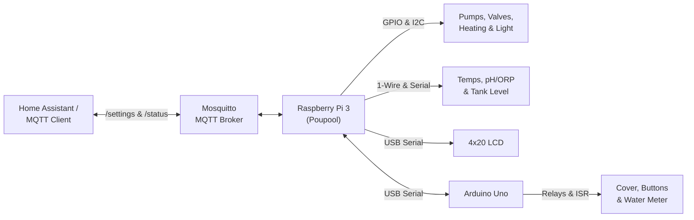

# Poupool User Manual

Poupool controls an overflow swimming pool from a Raspberry Pi 3 and an Arduino Uno, using commercial off-the-shelf relays, probes, and sensors. Control and telemetry run over MQTT, with a ready-to-use Home Assistant dashboard and a small 4x20 character display in the plant room.

{: .hero-photo }

An overflow pool keeps water flush with the surrounding deck instead of sitting below wall skimmers. Water spills over the edge into a perimeter gutter and drains by gravity into a dedicated buffer tank, where a level sensor and motorized valves balance the volume between pool and tank. That hydraulic loop gives cleaner surface skimming and better circulation, at the cost of tighter coordination between pumps, valves, cover position, and tank reserve.

Poupool handles that coordination automatically alongside daily filtration scheduling, sand filter backwashes, pH and chlorine dosing with empty-canister alerts, heat pump scheduling, roller cover safety, underwater lighting, a variable-speed counter-current swim pump, and winter frost protection.

## How the pieces fit together

## What is in this manual

| Section | What it covers |
| :--- | :--- |
| [System & Hardware](architecture.md) | Raspberry Pi and Arduino hardware split, hydraulic circuit, and software actors |
| [Operating Modes](modes.md) | Pool modes, transition rules, valve states, and automatic standby/overflow switching |
| [Filtration & Backwash](filtration.md) | Daily Eco scheduling, pump speeds, solar cover stirring, and automated backwashes |
| [Buffer Tank](tank.md) | Tank level calibration, Eco vs Overflow bands, municipal refill, and dry-run protection |
| [Disinfection](disinfection.md) | Startup settling, proportional PWM dosing, safety cutoffs, and empty canister alerts |
| [Heating & Frost Protection](heating.md) | Daily heat pump scheduling, hysteresis, cool-down delays, wintering, and frost heater |
| [Cover, Swim Pump & Lighting](equipment.md) | Arduino roller cover safety, wall calibration buttons, water meter, swim jets, and lights |
| [Home Assistant, MQTT & LCD](interface.md) | Lovelace dashboard, complete MQTT topic reference, LCD screen, and settings backup |
| [Installation & Setup](setup.md) | Raspberry Pi OS setup, udev rules, `config.ini`, CLI test flags, and firmware flashing |
| [Chemistry & Control Basics](concepts.md) | Overflow hydraulics, pH, ORP, hysteresis, and proportional PWM explained plainly |
