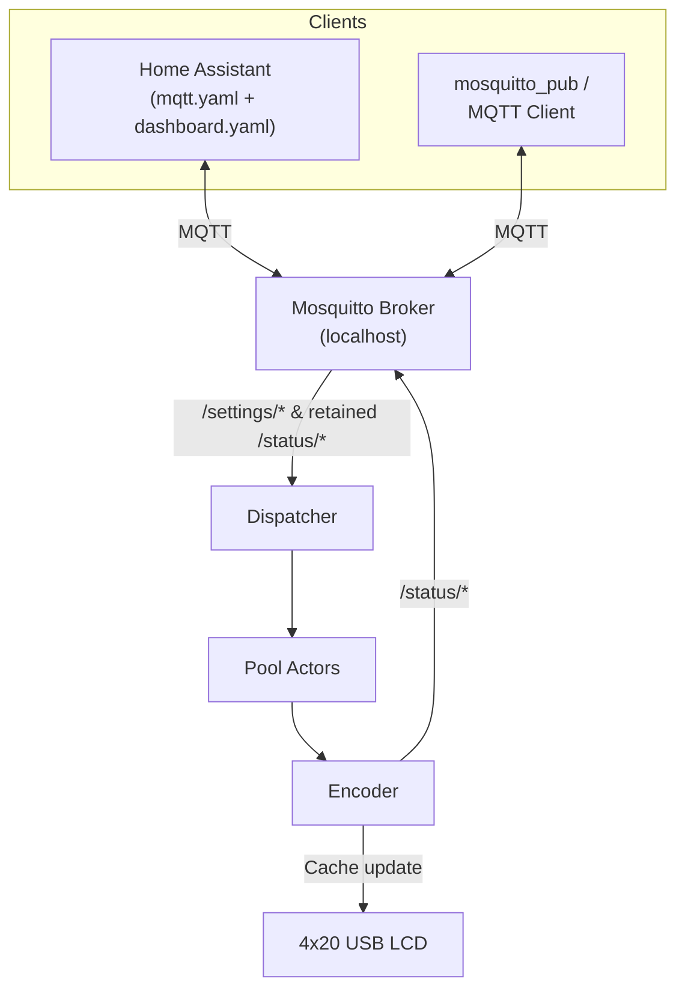

# Home Assistant, MQTT & LCD

Poupool exposes every setting and status value over MQTT, pairs with a ready-made Home Assistant integration and Lovelace dashboard, and mirrors key plant-room figures on a local 4x20 character LCD.

## Home Assistant integration

All MQTT entities live in [home-assistant/mqtt.yaml](https://github.com/lostcontrol/poupool/blob/master/home-assistant/mqtt.yaml) and group cleanly under one device (`identifiers: "Poupool01"`, `name: "Poupool"`). That includes `select`, `number`, `switch`, `climate`, `light`, `sensor`, and `binary_sensor` entities covering filtration modes, pump speeds, chemical setpoints, heating schedules, counter-current swimming, and empty-canister alerts.

A three-tab Lovelace layout is provided in [home-assistant/dashboard.yaml](https://github.com/lostcontrol/poupool/blob/master/home-assistant/dashboard.yaml):

- **Home (`home`)**: quick mode buttons (`Eco`, `Overflow`, `Standby`, `Comfort`), tank level gauge, pool temperature, pH/ORP tiles, counter-current controls, lights, and heating thermostat.
- **Informations (`information`)**: 24-hour and 30-day charts for filtration state, all four temperature sensors, buffer tank level, ORP, pH, and dosing pump duty cycles.
- **Settings (`settings`)**: every adjustable threshold, duration, pump speed, P-gain, and automation toggle (`auto_overflow`, `auto_standby`, `overflow_in_comfort`, `force_empty`).

{: .tip }
Wire a Home Assistant automation to `binary_sensor.poupool_desinfection_ph_canister_empty` and `binary_sensor.poupool_desinfection_cl_canister_empty` to get push notifications on your phone as soon as a chemical jug runs dry.

## MQTT topic convention

Poupool uses two top-level MQTT namespaces:

- `/settings/...` receives commands and tuning parameters. Most settings are published with the MQTT `retain` flag so the broker replays your saved configuration automatically whenever Poupool reconnects or restarts.
- `/status/...` carries live telemetry published by `Encoder`. Values that must survive a reboot (such as today's filtration runtime, total heating runtime, water counter, last backwash timestamp, and empty-canister flags) are published with `retain=True` and subscribed back through `Dispatcher` on startup.

## Complete MQTT topic reference

### Mode, filtration, and cover

| Topic | Direction | Values / Range | Retained |
| :--- | :--- | :--- | :--- |
| `/settings/mode` | Command | `halt`, `eco`, `standby`, `overflow`, `comfort`, `sweep`, `wash`, `wintering` | Yes |
| `/settings/filtration/duration` | Setting | `1` to `172800` (seconds) | Yes |
| `/settings/filtration/period` | Setting | `1` to `10` (periods per day) | Yes |
| `/settings/filtration/reset_hour` | Setting | `0` to `23` (hour of day) | Yes |
| `/settings/filtration/tank_percentage` | Setting | `0` to `0.5` (fraction of period) | Yes |
| `/settings/filtration/stir_duration` | Setting | `0` to `600` (seconds) | Yes |
| `/settings/filtration/stir_period` | Setting | `0` to `7200` (seconds) | Yes |
| `/settings/filtration/boost_duration` | Setting | `0` to `600` (seconds) | Yes |
| `/settings/filtration/speed/eco` | Setting | `1` to `3` | Yes |
| `/settings/filtration/speed/standby` | Setting | `0` to `2` | Yes |
| `/settings/filtration/speed/overflow` | Setting | `1` to `4` (`4` enables `boost`) | Yes |
| `/settings/filtration/overflow_in_comfort` | Setting | `0`/`1`, `off`/`on` | Yes |
| `/settings/filtration/auto_overflow` | Setting | `0`/`1`, `off`/`on` | Yes |
| `/settings/filtration/auto_standby` | Setting | `0`/`1`, `off`/`on` | Yes |
| `/settings/filtration/backwash/period` | Setting | `2` to `90` (days; `< 2` rejected) | Yes |
| `/settings/filtration/backwash/backwash_duration` | Setting | `0` to `300` (seconds) | Yes |
| `/settings/filtration/backwash/rinse_duration` | Setting | `0` to `300` (seconds) | Yes |
| `/settings/cover/position/eco` | Setting | `0` to `100` (%) | Yes |
| `/status/filtration/state` | Telemetry | Active substate (e.g. `eco_normal`, `opening_40`) | No |
| `/status/filtration/next` | Telemetry | `HH:MM:SS` remaining in current period | No |
| `/status/filtration/remaining` | Telemetry | `HH:MM:SS` remaining in daily budget | No |
| `/status/filtration/duration` | State sync | `0` to `86400` (seconds elapsed today) | Yes |
| `/status/filtration/backwash/last` | State sync | Timestamp (`%c` format) | Yes |

### Buffer tank and water meter

| Topic | Direction | Values / Range | Retained |
| :--- | :--- | :--- | :--- |
| `/settings/tank/force_empty` | Setting | `0`/`1`, `off`/`on` | Yes |
| `/status/tank/state` | Telemetry | `halt`, `fill`, `low`, `normal`, `high` | No |
| `/status/tank/height` | Telemetry | `0` to `100` (%) | No |
| `/status/water/counter` | State sync | Non-negative pulse count | Yes |

### Disinfection

| Topic | Direction | Values / Range | Retained |
| :--- | :--- | :--- | :--- |
| `/settings/disinfection/ph/enable` | Setting | `0`/`1`, `off`/`on` | Yes |
| `/settings/disinfection/ph/setpoint` | Setting | `6` to `8` (pH) | Yes |
| `/settings/disinfection/ph/pterm` | Setting | `0` to `10` | Yes |
| `/settings/disinfection/orp/enable` | Setting | `0`/`1`, `off`/`on` | Yes |
| `/settings/disinfection/orp/setpoint` | Setting | `500` to `800` (mV) | Yes |
| `/settings/disinfection/orp/pterm` | Setting | `0` to `10` | Yes |
| `/status/disinfection/state` | Telemetry | `halt`, `waiting`, `adjusting`, `treating` | No |
| `/status/disinfection/ph/value` | Telemetry | 5-minute average pH (only while running) | No |
| `/status/disinfection/orp/value` | Telemetry | 5-minute average ORP in mV (only while running) | No |
| `/status/disinfection/ph/feedback` | Telemetry | `0` to `100` (% PWM duty cycle) | No |
| `/status/disinfection/cl/feedback` | Telemetry | `0` to `100` (% PWM duty cycle) | No |
| `/status/disinfection/ph/canister_empty` | State sync | `0` or `1` | Yes |
| `/status/disinfection/cl/canister_empty` | State sync | `0` or `1` | Yes |

### Heating, temperatures, swim pump, and light

| Topic | Direction | Values / Range | Retained |
| :--- | :--- | :--- | :--- |
| `/settings/heating/enable` | Setting | `0`/`1`, `off`/`on` | Yes |
| `/settings/heating/setpoint` | Setting | `10` to `32` (°C) | Yes |
| `/settings/heating/start_hour` | Setting | `0` to `23` | Yes |
| `/settings/heating/min_temp` | Setting | `5` to `25` (°C ambient cutoff) | Yes |
| `/settings/heater/setpoint` | Setting | `0` to `30` (°C plant room frost guard) | Yes |
| `/status/heating/state` | Telemetry | `halt`, `waiting`, `heating`, `recovering` | No |
| `/status/heating/total_seconds` | State sync | Cumulative heat pump runtime (seconds) | Yes |
| `/settings/swim/mode` | Command | `halt`, `timed`, `continuous` | Yes |
| `/settings/swim/timer` | Setting | `1` to `60` (minutes) | Yes |
| `/settings/swim/speed` | Setting | `1` to `100` (%) | Yes |
| `/status/swim/state` | Telemetry | `halt`, `timed`, `continuous`, `wintering_waiting`, `wintering_stir` | No |
| `/settings/light/mode` | Command | `halt`, `on` | Yes |
| `/status/light/state` | Telemetry | `halt`, `on` | No |
| `/status/temperature/pool` | Telemetry | Pool water temperature (°C) | No |
| `/status/temperature/air` | Telemetry | Outside air temperature (°C) | No |
| `/status/temperature/local` | Telemetry | Technical room temperature (°C) | No |
| `/status/temperature/ncc` | Telemetry | Counter-current pit temperature (°C) | No |
| `/status/temperature/pool_slope` | Telemetry | Pool heating/cooling rate (°C/hour) | No |

## Plant-room 4x20 LCD display

If a USB-serial LCD backpack is connected at `/dev/lcd`, the `Lcd` actor refreshes it every 2 seconds with the current filtration state, pool and air temperatures, pH and ORP readings (shown as dashes while disinfection is stopped or warming up), and the remaining countdown for the active Eco timer. When Poupool stops cleanly, the LCD clears and shows `POUPOOL / NOT RUNNING`.

<figure class="figure-card">
  
  <figcaption>Layout of the 4x20 plant-room display managed by controller/lcd.py.</figcaption>
</figure>

## Initializing and backing up MQTT settings

Because Poupool stores live configuration in retained MQTT topics rather than overwriting local files, two helper scripts sit at the repository root:

- `default_settings.py`: publishes sane initial retained values for every setting topic to a fresh Mosquitto broker and reports any missing or unused topics against `Dispatcher`.
- `backup_settings.py`: connects to the local broker, reads retained topics (ignoring `/status/filtration/duration`), and writes `backup.txt` as a list of `mosquitto_pub -t ... -m ... -r` commands you can replay after rebuilding a Pi or broker.
