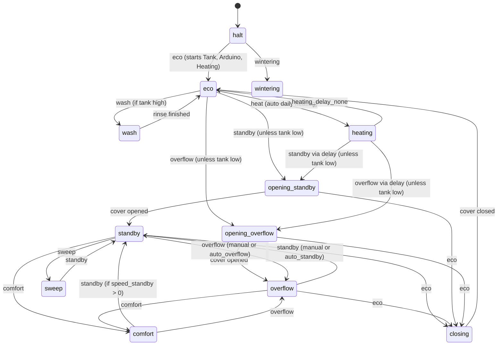
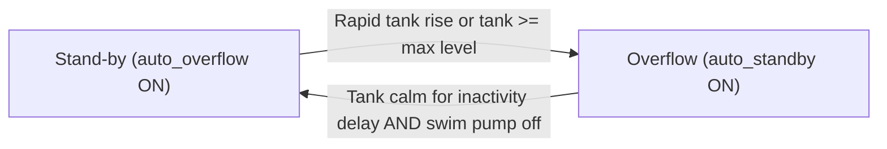

# Operating Modes

Poupool organizes pool operation around named modes. Requesting a mode from Home Assistant or MQTT triggers transitions in the main `Filtration` state machine, which coordinates the roller cover, pump speeds, valves, buffer tank thresholds, disinfection, heating, and the swim pump.

Not every mode can jump directly to every other mode. Opening the pool is blocked when the buffer tank is low, backwashing is only allowed from Eco when the tank is full enough, and wintering can only start from `halt` so the buffer tank stays offline for the winter.

Selecting `halt` from any active mode stops all pumps, valves, and child actors immediately and returns `Filtration` to `halt`.

When switching between closed (`eco`) and open (`standby` or `overflow`), the controller pauses in `opening` or `closing`. Both pumps stop while the cover moves so water turbulence does not strain the slats, and `Filtration` publishes progress in 10% steps (`opening_0` to `opening_100`, `closing_100` to `closing_0`).

## Mode comparison

| Mode | Cover | Pumps | Active Valves | Disinfection | Heating |
| :--- | :--- | :--- | :--- | :--- | :--- |
| `eco` | Closed (or `cover_position_eco`) | `speed_eco` (1 in `eco_tank`, off waiting) + solar stir pulses | `gravity` ON (`tank` ON in `eco_tank`) | On while filtering pool | Auto daily run |
| `standby` | Open | `speed_standby` (3 + `boost` during boost) | `gravity` OFF, `tank` OFF (`tank` ON in boost) | On if `speed_standby > 0` | Off |
| `overflow` | Open | `speed_overflow` (`4` or boost enables `boost`) | `gravity` OFF, `tank` ON | On at speed 1 or 2 | Off |
| `comfort` | Open | Variable speed 2 | `gravity` OFF, `tank` ON if `overflow_in_comfort` | On | Forced ON |
| `sweep` | Open | Variable speed 3 | `gravity` ON, `tank` OFF | Off | Off |
| `wash` | Closed | Variable speed 3 | `tank` ON, `drain` ON (`backwash` in phase 1) | Off | Off |
| `wintering` | Open | Periodic stir (`pump_speed`) | Off (unchanged) | Off | Room frost heater only |
| `halt` | Stopped | Off | All OFF | Off | Off |

## Main modes

### Eco

Eco is the normal closed-cover mode when nobody is using the pool. Entering `eco` turns off the underwater light, sets the buffer tank thresholds to Eco mode, and splits the day's filtration target into evenly spaced periods. Each filtration period runs pool filtration (`eco_normal`) followed by a short buffer tank pass (`eco_tank`), then rests in `eco_waiting` until the next period starts. If automatic daily heating triggers from `eco_waiting` or `eco_normal`, filtration enters `heating_running` at speed 2 until the pool reaches temperature, then cools down through `heating_delay` before returning to Eco.

### Stand-by

Stand-by keeps the cover open without actively spilling water over the pool edge. When entering `standby`, the controller switches `gravity` off and keeps `tank` off during normal standby, running the variable pump at `speed_standby` (from `0` to `2`). If `speed_standby` is greater than `0`, disinfection runs as usual; if it is `0`, disinfection stays halted. Stand-by counts toward daily filtration hours only when `speed_standby > 0`.

Opening from `eco` lands in `standby_boost` first so a short high-flow burst (`boost_duration`, default 5 minutes) clears surface dust before settling into `standby`. You can also trigger another boost burst manually by selecting `standby` again while already in `standby`.

If swimmers get into the pool while it is in Stand-by and displace water into the perimeter gutter, the buffer tank level rises. When `auto_overflow` is enabled, Poupool watches the tank level after a brief settling grace period and automatically switches to **Overflow** if the level climbs sharply or approaches tank capacity, pumping the displaced water back into the pool instead of losing it down the overflow drain.

### Overflow

Overflow gives the pool its mirror surface: water spills continuously over the deck edge into the gutter and drains to the buffer tank while the pump draws from `tank` (`tank` valve ON, `gravity` OFF) to keep the edge fed. Pump speed follows `speed_overflow` (`1` to `4`, where `4` runs the variable pump at speed 3 plus the `boost` pump). Disinfection runs when `speed_overflow` is `1` or `2` so flow through the probe chamber stays within measurement range.

Like Stand-by, opening straight into Overflow runs a `boost_duration` burst first, and selecting `overflow` again while in `overflow` triggers a manual boost.

When everyone gets out and the pool sits calm, keeping the overflow running wastes electricity and accelerates cooling and evaporation. When `auto_standby` is enabled, Poupool monitors tank level variation and returns to **Stand-by** automatically after the tank stays quiet for the configured inactivity window (and the counter-current swim pump is off).

### Comfort

Comfort is meant for active swimming when you want guaranteed heating. It runs the filtration pump at speed 2 with disinfection active, forces the `Heating` actor into `forcing` mode (bypassing the daily schedule and ambient air checks), and either overflows or stays on standby depending on the `overflow_in_comfort` switch. Daily filtration time accrues at half rate (`0.5x`) in Comfort mode.

{: .note }
You cannot switch straight from `comfort` to `standby` if `speed_standby` is set to `0`. Switch to `overflow` or increase `speed_standby` above `0` first.

## Advanced modes

### Sweep

Sweep prepares the pool for manual vacuuming or a suction cleaner. It is reachable only from `standby` and returns only to `standby` (or `halt`). It opens `gravity`, closes `tank`, runs the filtration pump at speed 3 for strong suction, and halts disinfection so concentrated vacuumed debris or chemicals never hit the probes.

### Backwash

Backwash cleans the sand filter automatically or on demand. It can only start from `eco_normal` or `eco_waiting` when the buffer tank state is `high`, because flushing the filter uses a noticeable amount of tank water. A backwash cycle runs two timed stages (backwash then rinse) and returns straight to `eco` afterward. See [Filtration & Backwash](filtration.md) for the full valve sequence.

### Wintering

Wintering protects the pipes, filter, and counter-current unit during freezing weather without keeping the buffer tank full. It is reachable only from `halt` so the `Tank` actor stays in `halt` and never refills the buffer tank. On entry, Poupool commands the roller cover completely open so ice cannot crush the slats, enables the optional plant-room frost `Heater`, and puts both `Filtration` and `Swim` into their periodic freeze-stirring loops.

### Halt

Halt is the full system stop for maintenance or winterization. It halts `Disinfection`, `Tank`, `Arduino` (stopping any cover movement), `Heating`, `Light`, and `Swim`, and turns off the filtration pumps and all four filtration valves (`gravity`, `backwash`, `tank`, `drain`).
