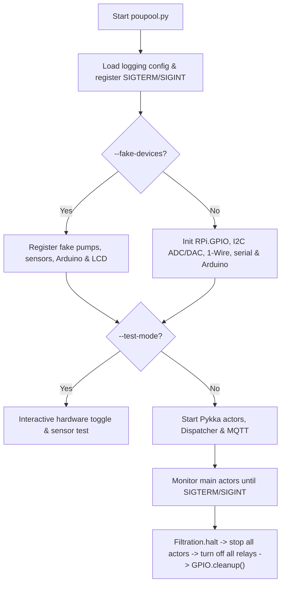

# Installation & Setup

Poupool targets a **Raspberry Pi 3 Model B+** running Linux alongside an **Arduino Uno** over USB. You can also run the controller on a workstation with simulated devices to test logic or Home Assistant dashboards without pool hardware attached.

## Raspberry Pi preparation

1. **Enable I2C and 1-Wire**: copy or merge the relevant lines from `raspberrypi/config.txt` into your Pi boot config so I2C (`dtparam=i2c_arm=on`) and 1-Wire on GPIO 7 (`dtoverlay=w1-gpio,gpiopin=7`) are active at boot.
2. **Install udev rules**: copy `raspberrypi/50-arduino.rules`, `raspberrypi/50-ezo-sensors.rules`, and `raspberrypi/50-lcd.rules` into `/etc/udev/rules.d/` and reload udev. Note that `50-ezo-sensors.rules` matches the FTDI USB-serial adapter serial numbers, so update those serial strings to match your own pH and ORP adapters.
3. **Install Mosquitto and Python 3.11+**: install `mosquitto` as the local MQTT broker, then install `uv` and run `uv sync` inside the repository to create `.venv` with all Raspberry Pi GPIO, I2C, and MQTT dependencies.
4. **Seed default MQTT settings**: run `uv run python default_settings.py` once so the broker holds retained defaults before starting the controller.
5. **Install the systemd unit**: copy `raspberrypi/poupool.service` to `/etc/systemd/system/`, adjust paths if needed, and enable it. The unit waits for `mosquitto.service` and the `/dev/arduino`, `/dev/ezo_ph`, and `/dev/ezo_orp` udev devices before launching.

## Configuration (`config.ini` and `config.ini.local`)

Poupool loads `config.ini` first and `config.ini.local` second. Put site-specific overrides in `config.ini.local` (which is ignored by git) so repository updates never overwrite your hardware IDs or calibrated tank voltages.

| Section | Keys | Purpose |
| :--- | :--- | :--- |
| `[pins]` | `variable`, `boost`, `swim`, `ph`, `cl`, `gravity`, `backwash`, `tank`, `drain`, `main`, `heating`, `light` | BCM GPIO pin assignments for pumps, valves, and relays |
| `[serial]` | `ph`, `orp`, `arduino`, `lcd` | Serial device paths (`/dev/ezo_ph`, `/dev/ezo_orp`, `/dev/arduino`, `/dev/lcd`) |
| `[adc]` | `channel`, `gain`, `low`, `high` | ADS1015 channel, gain, and `0%` / `100%` voltage calibration for the tank sensor |
| `[1-wire]` | `pool`, `air`, `local`, `ncc` | DS18B20 1-Wire sensor hardware addresses (`28-...`) |
| `[misc]` | `location`, `solar_elevation` | City name and sun elevation threshold (degrees) for `StirMode` |
| `[tank]` | `hysteresis`, `too_low`, `eco_low`, `eco_high`, `overflow_low`, `overflow_high`, `auto_overflow_*`, `auto_standby_*` | Buffer tank level bands and auto-overflow / auto-standby windows |
| `[disinfection]` | `start_delay`, `waiting_delay`, `security_duration`, `ph_pwm_period`, `cl_pwm_period`, `canister_cycles` | Settling delay, loop interval, PWM periods, daily runtime limit, and canister trend window |
| `[heating]` | `delay_to_eco`, `delay_to_open`, `hysteresis_down`, `hysteresis_up`, `hysteresis_min_temp`, `recover_period` | Cool-down delays, temperature hysteresis, and compressor rest time |
| `[heater]` | `hysteresis_down`, `hysteresis_up` | Hysteresis band for the plant-room frost heater |
| `[wintering]` | `period`, `only_below`, `pump_speed`, `duration`, `swim_period`, `swim_only_below`, `swim_duration` | Freeze-stir intervals, air/pit temperature cutoffs, and pump durations |

## Running, testing, and clean shutdown

`poupool.py` supports five command-line flags for setup, diagnostics, and simulation:

- `--log-config <path>`: logging configuration file (defaults to `logging.conf`; `logging-debug.conf` and `logging-file.conf` are included).
- `--fake-devices`: replaces GPIO, I2C, 1-Wire, EZO sensors, Arduino, and LCD with in-memory fakes so you can run Poupool against a local Mosquitto broker on a laptop.
- `--test-mode`: interactive terminal walk-through that toggles each pump, valve, and relay for 2 seconds and prints live sensor readings.
- `--no-disinfection`: locks the `Disinfection` actor in `halt` even while filtering.
- `--test-start`: starts all actors, verifies startup, then shuts down cleanly after 2 seconds (used in CI).



On `SIGTERM` (from systemd) or `Ctrl+C`, `poupool.py` triggers `Filtration.halt()`, stops all Pykka actors, turns every pump and valve off, calls `stop()` on serial devices (stopping cover motion and showing the stopped message on the LCD), and runs `GPIO.cleanup()`.

## Arduino cover firmware

The cover firmware in `arduino/cover/` builds with PlatformIO (included as a development dependency via `uv sync`). To compile and upload from the repository root:

```sh
uv run pio run -d arduino/cover
uv run pio run -d arduino/cover -t upload
```

See [arduino/cover/README.md](https://github.com/lostcontrol/poupool/blob/master/arduino/cover/README.md) for custom serial port flags and serial monitor commands.
