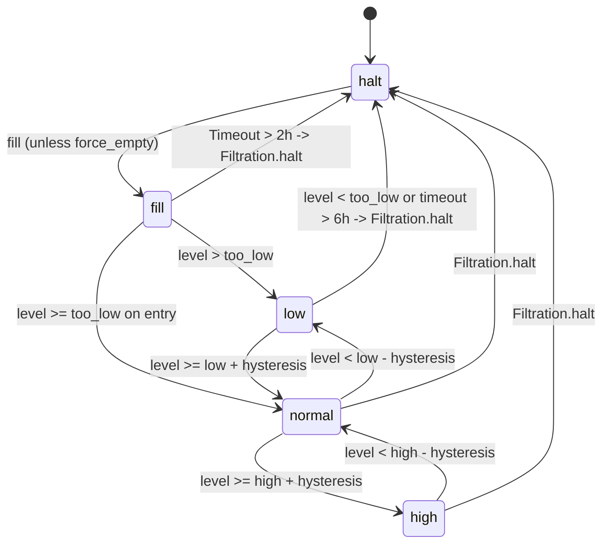

# Buffer Tank

An overflow pool needs a buffer tank to hold the water displaced when people jump in, store extra headroom for rain, and supply the water consumed during sand filter backwashes. The `Tank` actor monitors tank depth continuously and keeps the volume inside safe limits.

## Level measurement and calibration

A pressure or continuous level sensor wired to channel `1` of an **ADS1015** I2C analog-to-digital converter measures tank water depth. Each read averages ten voltage samples and maps the `[low, high]` voltage window from `[adc]` in `config.ini` onto a `0%` to `100%` scale. If the ADC stops responding, the sensor reports `0%` so the controller immediately shuts the system down rather than letting a pump run dry.

## Dynamic thresholds: Eco vs Overflow

Poupool switches tank thresholds automatically depending on whether the pool is closed or open.

<figure class="figure-card">
  
  <figcaption>Eco mode keeps a higher reserve for backwashes and rain; Overflow mode shifts the band down because part of the water is circulating over the pool edge.</figcaption>
</figure>

When the pool is in **Overflow** (or any open mode reached through `opening`), the filtration pump pulls water out of the buffer tank and pushes it into the basin until water spills over the edge. Because that circulating volume sits out in the pool and gutter, the tank naturally rests lower, so Poupool sets `overflow_low = 20%` and `overflow_high = 60%`.

When the pool closes into **Eco**, the overflowing water drains back into the tank and raises its level. Poupool switches to `eco_low = 30%` and `eco_high = 90%`. Keeping `eco_low` at `30%` leaves enough space to catch heavy rain without sending water straight down the overflow drain, while `eco_high` at `90%` confirms there is plenty of water stored for an automated sand filter backwash.

Every threshold boundary applies `hysteresis` (`5%` by default) in both directions so wave ripples cannot make the refill solenoid chatter.

## Tank state machine and refill logic

When `Filtration` leaves `halt`, `Tank` enters `fill`:

- If the tank is already at or above `too_low` (`10%`), `fill` hands straight off to `normal` (which then moves to `low` or `high` on the next check if needed).
- If the tank starts below `too_low`, `Tank` opens the municipal `main` refill valve and stays in `fill` until the water rises past `too_low`, then moves to `low` until reaching `low + hysteresis`.
- In `normal` and `high`, the `main` valve stays closed.

## Dry-run and overflow protections

Several safeguards protect the main filtration pump and prevent endless water waste if a refill pipe fails or a valve sticks:

| Condition | Action taken |
| :--- | :--- |
| Level drops below `too_low` while in `low` | Triggers `Filtration.halt` immediately to prevent running dry |
| Tank stays in `fill` longer than 2 hours | Triggers `Filtration.halt` |
| Tank stays in `low` longer than 6 hours | Triggers `Filtration.halt` |
| Tank is `halt`, `fill`, or `low` | Blocks opening to `standby` or `overflow` and skips `eco_tank` filtration |
| Level rises quickly or reaches `auto_overflow_max_level` in `standby` | Switches `Filtration` to `overflow` when `auto_overflow` is enabled |
| Level stays calm for `auto_standby_delay` in `overflow` | Returns `Filtration` to `standby` when `auto_standby` is enabled and `Swim` is off |

## Draining the tank for maintenance (`force_empty`)

Toggling `force_empty` (`/settings/tank/force_empty`) prepares the tank for cleaning or winter shutdown. Enabling `force_empty` while the system is running triggers `Filtration.halt`, closes the municipal `main` valve, and prevents `Tank` from leaving `halt` until you turn `force_empty` back off.
